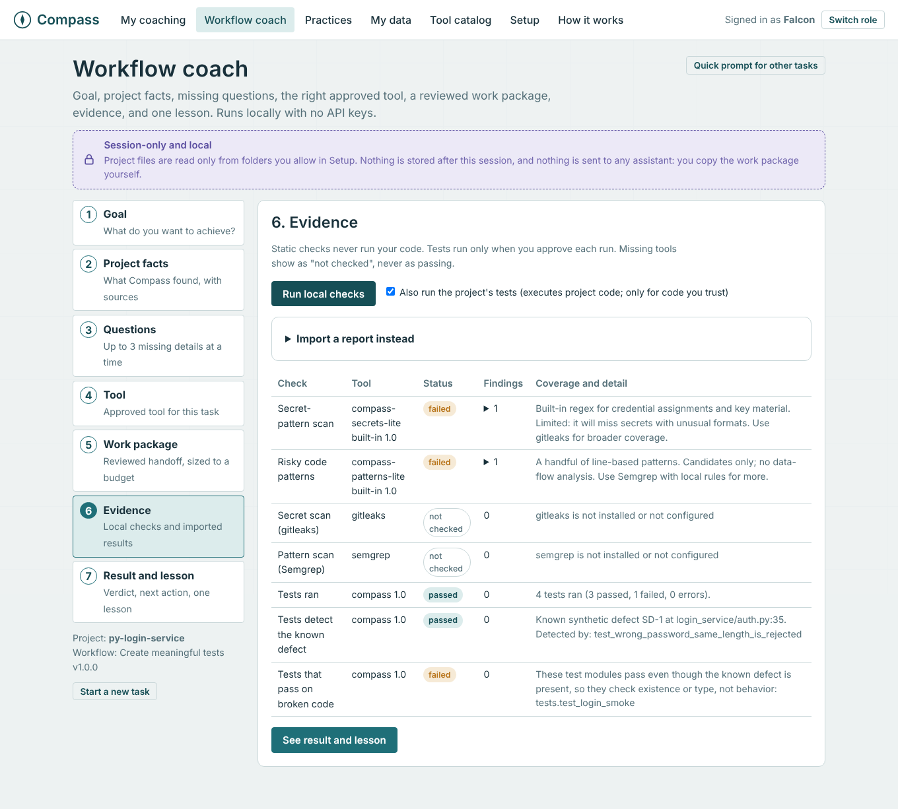
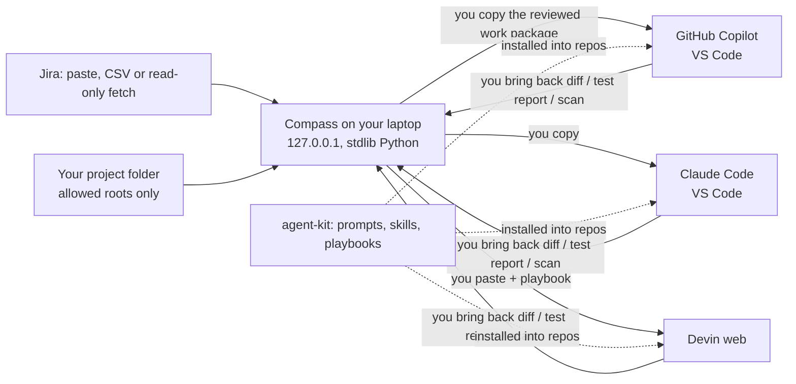

# Compass: AI Engineering Enablement Coach

**Trusted, private workflow coaching for GenAI adoption.**

Engineers already have GitHub Copilot, Claude Code and Devin. Access and usage counts don't show which workflows work, which tool fits which task, or whether the output is actually correct. Compass is a local coach that closes that gap. It works without API keys, MCP servers, a cloud backend or model downloads.

| Experience | What it does |
|---|---|
| **Workflow coach** | Goal, then project facts (with file:line sources), up to 3 missing questions, the approved tool for the task, a reviewed work package sized to a budget, local checks and imported evidence, and finally a verdict, the next action and one lesson. Three guided workflows: feature/API change, UAT defect investigation, meaningful test creation. Security review runs as a shared stage. |
| **Private coaching** | Next-best actions from GenAI usage and delivery signals. Each has an observation, an action, a rationale with sources, and an outcome to monitor. Only the engineer sees them. |
| **Team and portfolio insights** | k-anonymous (k ≥ 5) team patterns and enablement opportunities. No drill-down to people, no ranking. |
| **Agent kit** | Drop-in Copilot instructions and prompt files, Claude Code skills, Devin playbooks and a 54-prompt library for any repository. No MCP needed. |

> **Enablement, not evaluation.** Compass never scores, ranks, compares, profiles or labels people.



## Start

| How | Command |
|---|---|
| Windows | Double-click **`Start-Coach.bat`**, or drag a project folder onto it |
| Open straight into a project and a Jira issue | `Start-Coach.bat C:\code\my-repo ABC-123` |
| Any OS | `python -m compass` (add `--project <folder> --jira <KEY>`) |
| Check your setup | `python -m compass doctor` |

You need Python 3.9+ and nothing else: no pip install and no internet. On first run, open **Setup** and answer 8 questions:
1. Which AI tools you may use
2. Which of them may see internal code
3. Which project folders Compass may read
4. Jira (off, Cloud or Data Center)
5. Local scanners
6. Whether tests may run when you approve them
7. Default work-package size
8. Whether to allow a local cache

## Three demos in five minutes (synthetic projects)

| Demo | What you see |
|---|---|
| **Catch a missing API requirement** (`examples/java-orders-api`) | The story says nothing about auth, errors or headers. Compass detects the project standard (`standards/api-standard.md:10`) and asks for them. The checks then flag the spec: no `X-Correlation-Id`, no 400 on POST, no auth (`openapi.yaml:11`). Verdict: *Not accepted yet*. |
| **Reject a fix without reproduction evidence** (`examples/py-login-service`) | Compass runs the tests on temporary copies. The fix without a test is *Not accepted: no reproduction evidence*. The fix with a regression test that fails before and passes after is *Accepted with evidence*. Your files are never changed. |
| **A test that catches a seeded defect** (`examples/py-login-service`) | `test_wrong_password_same_length_is_rejected` detects the planted defect at `auth.py:35`. The smoke tests pass on broken code and are flagged as weak. Security candidates are reported: a synthetic credential and `shell=True`. |

## Results (measured; see [docs/measurements.md](docs/measurements.md))

| Check | Result |
|---|---|
| Tests (`python -m unittest discover -s tests -t . -v`) | **74 / 74 pass**: AC1-AC14 plus workflow, security-boundary, egress-blocked, timeout and Jira tests |
| Recommendation quality eval (target 80%) | **25 / 25**, plus 5/5 context pairs, 37/37 seeded personas, 16/16 routing stories |
| Real scanners via the approval flow | gitleaks 8.30.1, Semgrep 1.181.0 (local rules, metrics off), Spectral 6.17.0 (local ruleset) |
| Context size, 386-file repo, Deep budget | about 15k estimated tokens vs about 454k for pasting the whole repo (estimates, not billing) |

The team wrote the eval scenarios and tuned the rules on them, so treat the eval as regression tests, not held-out accuracy. [docs/testing.md](docs/testing.md) explains how to add held-out scenarios.

## How it fits your tools (no MCP, no API)



## What's inside

```
compass/            Python service: coaching engine, aggregation, prompt coach, API
compass/workflow/   Workflow coach: workspace + facts, packs + questions + tool policy, context budgeter,
                    work package, evidence + adapters, safe runner, cache, journey
workflows/packs/    Versioned workflow manifests (3 working, 1 shared security stage, 3 planned)
catalog/            Approved-capability catalog + 37-tool reviewed registry (all inactive) + JSON schema
compass_rules/      Pinned local Semgrep and Spectral rules
web/                Browser UI (vanilla JS, no CDN, works offline)
agent-kit/          Drop-in files for Copilot, Claude Code and Devin + prompt library
examples/           Synthetic fixture projects (Java API, Python login service, unknown stack)
tests/              74 tests; fixtures include real scanner outputs
docs/               Architecture, workflow coach design, setup, Jira, offline tools, measurements,
                    hand-off for Devin/Copilot/Claude, presentation, business case, NFRs
```

## Documentation

- **Start here:** [Setup](docs/setup.md) · [User guide](docs/user-guide.md) · [Demo script](docs/demo-script.md) · [Presentation (.pptx)](docs/presentation/Compass-Hackathon.pptx)
- **Design:** [Architecture](docs/architecture.md) · [Workflow coach design and decisions](docs/workflow-coach.md) · [Data dictionary](docs/data-dictionary.md)
- **Evidence:** [Measurements](docs/measurements.md) · [Implementation report](docs/IMPLEMENTATION-REPORT.md) · [Acceptance criteria traceability](docs/acceptance-criteria.md) · [Testing](docs/testing.md) · [Eval report](reports/eval-report.md)
- **Judging:** [Scoring rubric mapping](docs/rubric-mapping.md) · [Business case](docs/business-case.md) · [NFRs and security](docs/nfr-security.md) · [Responsible AI](docs/responsible-ai.md) · [Roadmap](docs/roadmap.md)
- **Operations:** [Offline use and scanner preparation](docs/offline-and-tools.md) · [Jira](docs/jira.md) · [Source manifest (37 tools)](docs/third-party/source-manifest.md)
- **Hand-off:** [Devin](docs/handoff/devin.md) · [Copilot](docs/handoff/copilot.md) · [Claude Code](docs/handoff/claude.md)
- **Agent kit:** [Agent kit](agent-kit/README.md) · [Tool routing guide](agent-kit/tool-routing-guide.md) · [Research brief (54 sourced claims)](docs/research/evidence.md)

## License

MIT. See [LICENSE](LICENSE). Third-party material in `agent-kit/vendor/` keeps its original MIT license; see [NOTICE.md](NOTICE.md) and the [source manifest](docs/third-party/source-manifest.md).
