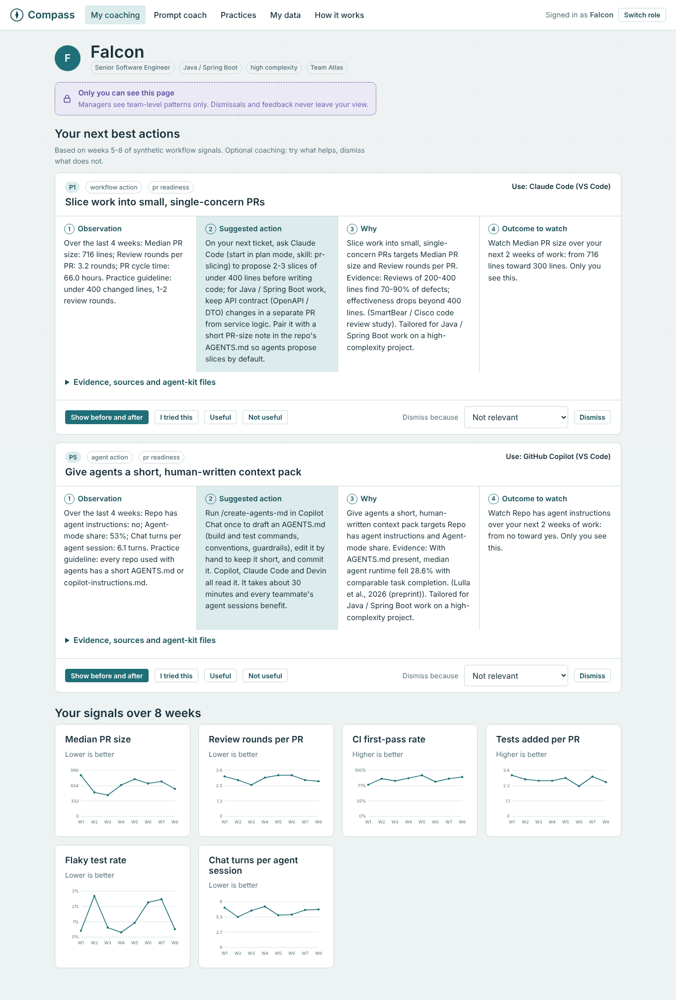

# Compass: AI Engineering Enablement Coach

**Trusted, private workflow coaching for GenAI adoption.**

Engineering organizations have rolled out GitHub Copilot, Claude Code, Devin and similar tools, but access and usage counts do not show which workflows work or where help is needed. Compass turns synthetic (or properly authorized) usage metadata and delivery signals into:

- **Private, persona-specific coaching for engineers.** One next-best action at a time: a prompt, an agent, a workflow or a learning step. Every recommendation has an observation, a suggested action, a rationale with cited evidence, and an outcome to monitor.
- **A prompt coach.** Paste a Jira story (or import a Jira CSV export, no API needed). Compass names what is missing, asks up to three questions, picks the right tool (Copilot, Claude Code, Devin, a writing assistant, or no AI at all) and writes a ready-to-paste prompt.
- **Aggregated, k-anonymous insights for managers and leaders.** Team patterns, common workflow gaps and enablement opportunities. No individual data, no drill-down, no ranking.
- **A drop-in agent kit** that works in any repository with no MCP servers and no API keys: Copilot instructions and prompt files, Claude Code skills, Devin playbooks and a 54-prompt library.

> **Enablement, not evaluation.** Compass never scores, ranks, compares, profiles or labels people.



## Run it in one step

| Platform | Do this |
|---|---|
| Windows | Double-click **`Start-Coach.bat`** |
| macOS / Linux | `./start-coach.sh` |
| Any | `python -m compass` |

Requirements: Python 3.9+ only. Standard library only, so there is nothing to `pip install`. It runs fully offline, uses no API keys, and binds to `127.0.0.1`. Your browser opens at <http://127.0.0.1:8765/>.

Run the tests and the quality evaluation: `Run-Tests.bat`, or

```
python -m unittest discover -s tests -t . -v
python -m compass eval
```

## Current results

| Check | Result |
|---|---|
| Recommendation quality across seeded scenarios (target 80%) | **25 / 25 pass** ([report](reports/eval-report.md)) |
| Context awareness (same signal, different persona, different action) | **5 / 5** |
| Seeded synthetic personas surface their seeded pattern | **37 / 37** |
| Prompt coach task type and tool routing | **16 / 16** |
| Acceptance tests mapped to AC1-AC14 | **34 / 34 pass** |
| Data-minimization and no-ranking checks | **all pass** |

The scenarios were written by the team, and the rules were tuned on them. Treat these as regression tests rather than held-out accuracy. See [docs/testing.md](docs/testing.md) for how to add held-out scenarios from the organizers' sample data.

## What is inside

```
compass/            Python service (stdlib only): engine, aggregation, prompt coach, API, eval
web/                Browser UI (vanilla JS, no CDN, works offline)
agent-kit/          Drop-in files for Copilot, Claude Code and Devin + prompt library
eval/               Seeded scenarios for the quality evaluation
tests/              Acceptance tests mapped to AC1-AC14
reports/            Generated evaluation report (Markdown + JSON)
data/               Sample Jira CSV export + synthetic dataset as CSV
docs/               Architecture, setup, demo script, business case, NFRs, rubric mapping
Start-Coach.bat     One-click launcher
```

## Four experiences

| Role | What they see | What they can never see |
|---|---|---|
| Engineer | Own recommendations, before/after simulation, trends, prompt coach, own feedback and history (deletable) | Anyone else's data |
| Engineering manager | Own team's aggregated adoption, medians, gaps shared by 5 or more engineers, enablement opportunities | Any individual's recommendations, prompts, history, dismissals or feedback |
| Engineering leader | Portfolio patterns, practices discovered in the data (labeled non-causal), teams listed alphabetically | Rankings, individual data, small teams (suppressed) |
| AI enablement team | Quality evaluation, compliance checks, access audit, practice catalog | Individual data |

These boundaries are enforced in the API, not just hidden in the UI. Engineer endpoints take the identity from the signed session and never from a parameter. The aggregation module only opens `signals.db` read-only and has no access to `private.db`.

## Documentation

- [Architecture](docs/architecture.md): components, data flow, privacy boundary, human review points
- [Setup and operations](docs/setup.md): install, configuration, running under corporate restrictions
- [User guide](docs/user-guide.md)
- [Five-minute demo script](docs/demo-script.md)
- [Acceptance criteria traceability (AC1-AC14)](docs/acceptance-criteria.md)
- [Scoring rubric mapping](docs/rubric-mapping.md)
- [Business case and ROI](docs/business-case.md)
- [NFRs, security and operational model](docs/nfr-security.md)
- [Responsible AI and guardrails](docs/responsible-ai.md)
- [Data dictionary](docs/data-dictionary.md)
- [Testing](docs/testing.md)
- [Roadmap](docs/roadmap.md)
- [Research evidence brief (54 sourced claims)](docs/research/evidence.md)
- [Agent kit](agent-kit/README.md) and [tool routing guide](agent-kit/tool-routing-guide.md)

## License

MIT. See [LICENSE](LICENSE). Third-party material in `agent-kit/vendor/` keeps its original MIT license; see [NOTICE.md](NOTICE.md).
