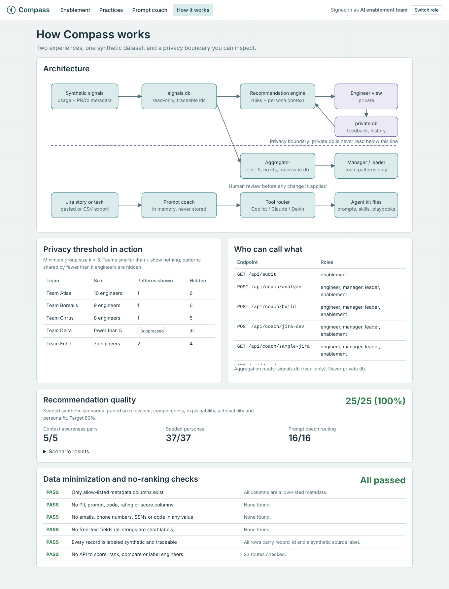
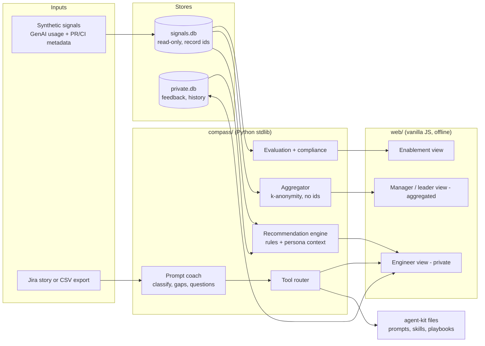
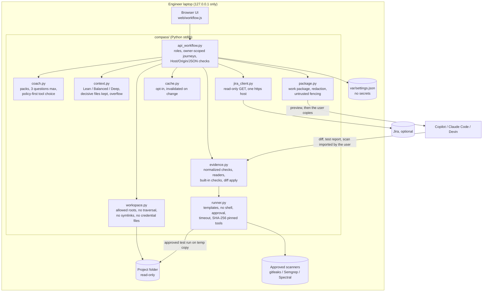

# Architecture

## Components

| Component | File | Responsibility |
|---|---|---|
| Synthetic data generator | `compass/synth.py` | Deterministic personas, teams and 8 weeks of signals with seeded patterns. Every row has a `record_id` and a `source` label. |
| Storage | `compass/db.py` | Two physically separate SQLite files: `signals.db` (metadata) and `private.db` (engineer-owned feedback and history). |
| Practice catalog | `compass/practices.py` | Eight reusable practices plus a learning path. Each one lists the signals it improves, sourced evidence, agent-kit files and labeled simulation assumptions. |
| Recommendation engine | `compass/engine.py` | Eleven named rules with fixed, practice-based thresholds (never peer comparison). Builds the four-element recommendation, tailors it to role, stack and complexity, cites evidence records, applies private feedback to ordering and detects progress. |
| Aggregator | `compass/aggregate.py` | Team and portfolio insights. Applies k-anonymity (default k = 5), hides patterns shared by fewer than k engineers, excludes suppressed teams from portfolio totals (differencing protection), and never touches `private.db`. Includes practice discovery with Pearson r, labeled non-causal. |
| Prompt coach | `compass/prompt_coach.py` | Task-type classification, brief checklist, up to three questions, anti-pattern notes, sensitive-data scan, tool routing and prompt generation for each tool. Jira CSV import. In memory only. |
| Optional LLM enhancer | `compass/llm.py` | Off by default. Can polish wording through an approved OpenAI-compatible endpoint. Nothing depends on it. |
| API and web host | `compass/server.py` | Role-based endpoints, HMAC-signed sessions, access audit (role, path, status only), security headers, static UI. |
| Evaluation | `compass/evaluation.py` | Grades seeded scenarios, context pairs, seeded personas and prompt routing. Writes `reports/`. |
| Compliance | `compass/compliance.py` | Schema allow-list, PII/code scan, free-text scan, synthetic-source check, no-ranking API check. |

## Request flow: engineer coaching

1. The engineer signs in. The demo uses a persona picker; production would use enterprise SSO. The server issues a signed session with `role=engineer` and `sub=<engineer id>`.
2. `GET /api/me/coaching` loads that engineer's signals from `signals.db`. There is no parameter that can select another engineer.
3. The engine computes the recent window (weeks 5-8) and baseline (weeks 1-4), fires rules, and builds recommendations with evidence record ids. It reads that engineer's latest private feedback to order them (AC13).
4. Shown recommendations are appended to `coaching_history` in `private.db`.
5. Feedback and dismissals go to `private.db` only. `POST /api/me/forget` deletes them.

## Request flow: manager insights

1. The manager signs in with `role=manager` and `sub=<team id>`.
2. `GET /api/team/insights` always uses the team from the session.
3. The aggregator opens `signals.db` read-only, computes per-engineer windows in memory, counts rule triggers, and returns only:
   - group size, when it is k or more; otherwise the whole team is suppressed
   - tool adoption shares, with cells under k hidden
   - team medians and weekly medians, shown only when k or more engineers contributed
   - gaps shared by k or more engineers, as rounded percentages, with an enablement opportunity and kit files
   - a count of hidden patterns
4. No engineer id, codename, recommendation text, feedback or history is present in the response. This is tested.

## Human review points

- **Engineer:** every recommendation is optional; the engineer decides to try, dismiss or give feedback.
- **Prompt coach:** generated prompts ask the agent for a plan first and to wait for approval; the UI states that the diff must be reviewed before merge. Compass never applies changes.
- **Agent kit:** every instruction file requires test evidence and human review before merge.
- **Manager:** enablement opportunities are suggestions for team-level actions (a session, a repo file), never actions about people.

## Why deterministic rules, not an LLM, at the core

- **Explainable:** each recommendation names its rule, threshold, signals and records.
- **Reproducible:** the same data always produces the same output, so the 80% quality gate is testable in CI.
- **Zero token cost and offline:** it works where no API keys are available.
- **Private:** no prompt or signal leaves the machine.

An LLM can be added later for phrasing (`compass/llm.py`) without changing the decision logic.

## Technology

Python 3.9+ standard library (`http.server`, `sqlite3`, `hmac`, `statistics`), vanilla JavaScript and inline SVG charts. No third-party runtime dependencies, so there is no supply-chain exposure and nothing to approve beyond Python.

## Workflow coach architecture (extension)

Key boundaries:
- The project folder is read-only. Fixes are verified on temporary copies.
- Nothing leaves the laptop unless the user copies it, or enables Jira or the optional LLM hook.
- Packs and the capability catalog are data files, so new workflows and tools are added without code changes to the journey.
