# Workflow coach: design, decisions and current state

The Workflow coach extends Compass. It does not replace it. The private coaching view, the k-anonymous manager and leader views, the prompt coach and the agent kit all keep working unchanged.

## The journey

```mermaid
flowchart LR
  G[1 Goal<br/>type, paste, Jira fetch, CSV, demo] --> F[2 Project facts<br/>detected / inferred / confirmed / unknown<br/>with file:line]
  F --> Q[3 Questions<br/>at most 3 at a time, each says why]
  Q --> T[4 Tool<br/>approval and data rules first,<br/>then capability fit; override within policy]
  T --> P[5 Work package<br/>Lean / Balanced / Deep budget,<br/>redaction, untrusted fencing, preview]
  P --> E[6 Evidence<br/>static checks, approved scanners,<br/>approved test runs, imported reports]
  E --> R[7 Result and lesson<br/>per-criterion verdict, next action,<br/>one teaching tip]
  P -. you copy it .-> A[(Copilot / Claude Code / Devin)]
  A -. you bring back diff, report .-> E
```

## Current-state map (what existed, what was reused)

| Existing component | Evidence | Reused for |
|---|---|---|
| Python stdlib HTTP server with role-based routes | `compass/server.py` (`route`, `Handler._dispatch`) | All new `/api/wf/*`, `/api/setup`, `/api/jira/*`, `/api/catalog/*` routes, registered from `compass/api_workflow.py` |
| Signed session and access audit | `compass/server.py` (`sign`, `verify`, `audit`) | Journeys are owned by the signed session (`role:sub`); the audit logs role, path and status only |
| Prompt coach classification and Jira CSV import | `compass/prompt_coach.py` | Kept as the **Quick prompt** for tasks outside the three workflows; office work now routes to Copilot / Claude Code |
| Secret patterns | `compass/prompt_coach.py` (`SENSITIVE`) | Extended in `compass/workflow/package.py` (`redact`) |
| Agent kit (skills, prompts, playbooks) | `agent-kit/` | Every tool recommendation points to the matching kit file. Prompts and skills are **not** auto-installed |
| Vanilla JS UI and SVG charts | `web/app.js`, `web/charts.js` | New `web/workflow.js` plugs into the same router and helpers |
| unittest suite and CI | `tests/`, `.github/workflows/ci.yml` | 40 new tests in `tests/test_workflow.py`; CI unchanged |

## Implementation decisions

1. **Same stack, no new framework.** Everything is Python standard library plus vanilla JS. Nothing to pip-install keeps it runnable on a locked-down laptop.
2. **Workflow packs are data.** `workflows/packs/*.json` are versioned manifests with required facts, conditional questions, staged instructions, acceptance criteria, checks, evidence requirements, supported stacks, a teaching tip and an exercise. Three are working (`feature-api`, `uat-defect`, `test-creation`). `security-review` is a shared stage. `pr-review`, `docs-onboarding` and `release-config` are registered as `planned`: the UI shows them disabled and the API refuses them.
3. **Facts carry provenance.** Each fact is `detected` (found in a file, with `{path, line}`), `inferred` (a convention such as `mvn -q test` that must be confirmed), `confirmed` (by the user) or `unknown`. Nothing is invented. Deep detection supports Java/Maven, Java/Gradle, Python, Node and .NET. For other stacks Compass says detection is unavailable and asks.
4. **Tool choice is policy first.** `catalog/capabilities.json` is the editable approved-capability catalog, and the Setup page overrides approvals per user. Filtering runs in this order: approval, then data class (synthetic / internal / restricted), then capability and fit by complexity and scope. Restricted data routes to "no AI" until the data is removed. Formatting chores route to the project's formatter. Overrides outside policy are refused.
5. **Context budgeter, not a mega-prompt.** Decisive files (API spec, standard, most relevant source, related tests, files named in the task) are always included in full. Optional files are included whole, as excerpts with line ranges, or listed as not included with a reason. If decisive context does not fit, the result is an **overflow**: export is disabled until the user picks a bigger budget or explicitly removes a file. Patches and fixture metadata are never sent. Token counts are labeled estimates (characters / 4), and exact bytes are always reported.
6. **Untrusted content stays data.** Project files go inside a fenced "untrusted project content" section. Instruction-like lines ("ignore previous instructions", `curl ... | sh`) are flagged. Workspace files can never change settings, approvals or allowlists.
7. **Evidence is normalized and honest.** Every check records tool, version, scope, snapshot hash, timestamp, completion, findings and coverage, with status `passed`, `failed`, `not-checked` or `blocked`. Findings start as `candidate`. Missing tools are `not checked`. A test file that exists is not proof it ran. Malformed reports are `blocked`, with the parse error shown.
8. **Execution is opt-in and bounded.** Only named command templates run. There is no shell, arguments are validated, paths are confined, the environment is minimal, and every run has a timeout, CPU limit (POSIX), output cap and cancel. Running tests needs the Setup switch **and** per-run approval. Fix verification runs on temporary copies and never edits the project. Scanners run only from a path the user approved, and only while its SHA-256 still matches.
9. **Session-only by default.** Journeys live in memory for 8 hours and can be deleted. The cache is off by default; when on, it is per project and its key covers the source snapshot, settings, rules and packs, so stale entries are deleted rather than reused.

## Acceptance logic per workflow

| Workflow | Criteria | Evidence that satisfies them |
|---|---|---|
| Feature / API | AC-API-1 header (when the standard requires it), AC-API-2 400 responses, AC-API-3 auth, AC-API-4 tests ran and passed, AC-SEC-1 secrets | Built-in OpenAPI checks or Spectral, a JUnit/unittest report (imported or run), secret checks |
| UAT defect | AC-DEF-1 regression test in the change, AC-DEF-2 fails before, AC-DEF-3 passes after with the full suite, AC-SEC-1 secrets in the diff | `verify-fix`: tests on a temp copy with only the diff's test changes, then on a temp copy with the full fix. Or imported before/after reports. With no before-fix evidence the verdict is **Not accepted: no reproduction evidence** |
| Test creation | AC-TST-1 tests ran, AC-TST-2 detects the known defect, AC-TST-3 flags suites that pass on broken code, AC-SEC-1 | A test run against a project with a declared synthetic defect (`compass-fixture.json`). Without a declared defect, AC-TST-2 is "not checked" and mutation testing is listed as an optional capability |

## Limits (stated in the UI too)

- The OpenAPI check is line-based for YAML and structural for JSON. It is not a full validator; use Spectral with your ruleset for complete linting.
- The built-in secret and pattern checks are short regex lists and will miss things. Use gitleaks and Semgrep with local rules for broader coverage.
- Compass has no OS-enforced sandbox. Test execution is for code you trust, and security review of untrusted code stays static-only.
- The workflow classifier is keyword-based. The user can always pick the workflow.
